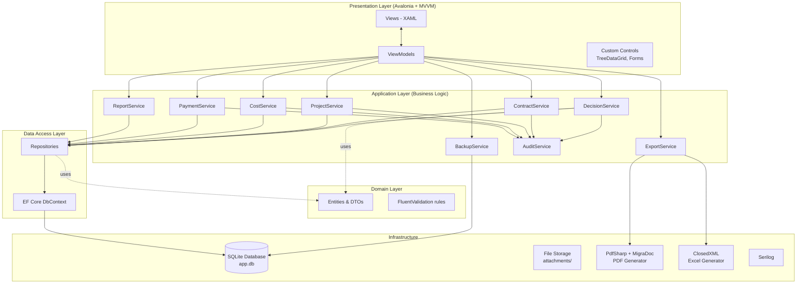
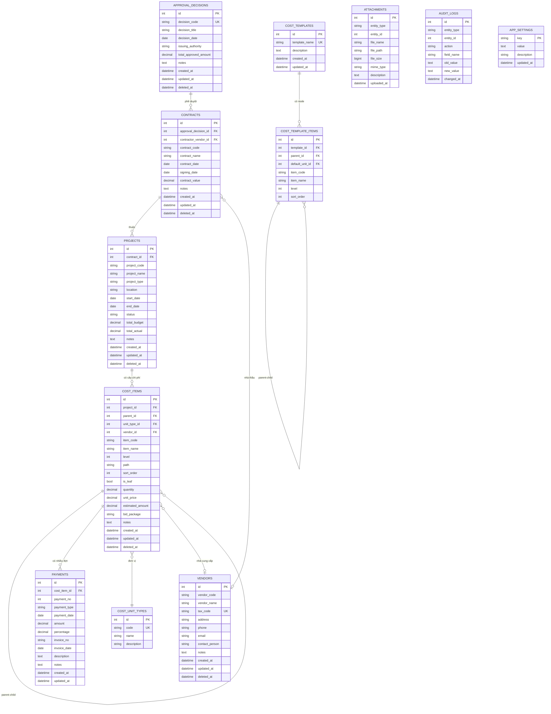

# Construction Finance Management Desktop App — Design Document

**Version**: 1.0
**Date**: 2026-05-19
**Status**: Draft for review
**Author**: Brainstorming session

---

## 1. Tổng quan

### 1.1. Mục tiêu

Xây dựng một ứng dụng desktop Windows hỗ trợ **quản lý tài chính cho công trình xây dựng** trong cơ quan nhà nước. Ứng dụng cho phép:

- Quản lý cây nghiệp vụ 4 cấp: **Quyết định phê duyệt → Hợp đồng → Dự án → Đầu mục chi phí**
- Theo dõi chi tiết tài chính từng đầu mục với khả năng nhập KL × Đơn giá, gắn nhà cung cấp, nhiều đợt thanh toán
- Nhập liệu giống Excel cho phần đầu mục chi phí (cây nhiều cấp)
- Xuất file Excel/PDF báo cáo theo chuẩn văn bản hành chính Việt Nam
- Backup/Restore + chia sẻ dữ liệu giữa các máy qua file `.cfb`

### 1.2. Ràng buộc

| Ràng buộc | Chi tiết |
|---|---|
| Mô hình triển khai | Single-user, standalone trên Windows |
| Phân phối | File `.exe` cài đặt, không cần dependencies ngoài |
| License | 100% MIT/Apache/BSD (cơ quan nhà nước không dùng được Community License có ngưỡng doanh thu) |
| Ngôn ngữ | Tiếng Việt (UI và báo cáo), tương lai có thể mở rộng English |
| Tiền tệ | Chỉ VND |
| Cấu trúc dữ liệu | Cây nghiệp vụ cứng theo ràng buộc: QĐ → HĐ → DA → CP |
| Đầu mục chi phí | Cấu trúc cây nhiều cấp (parent-child, không giới hạn level) |

### 1.3. Quyết định thiết kế cốt lõi

| # | Quyết định | Lý do |
|---|---|---|
| 1 | SQLite local (file `app.db`) | Single-user, đơn giản, không cần server |
| 2 | Avalonia 11 thay vì WPF | Có `TreeDataGrid` MIT free — bắt buộc cho cấu trúc cây chi phí |
| 3 | Clean Architecture / Layered + MVVM | Tách rõ Domain / Application / Infrastructure / Presentation, dễ test và bảo trì |
| 4 | Polymorphic attachments | Đính kèm file vào bất kỳ entity nào (QĐ, HĐ, DA, payment) |
| 5 | Soft delete + Audit log | Bảo toàn dữ liệu tài chính, có thể trace lịch sử |
| 6 | Backup format `.cfb` (ZIP) | Standalone, có manifest + checksum, chia sẻ giữa các máy |
| 7 | Materialized path cho cây chi phí | Query subtree nhanh, không cần đệ quy CTE |

---

## 2. Kiến trúc hệ thống

### 2.1. Sơ đồ kiến trúc tổng



### 2.2. Quy tắc dependency

- `Presentation` → `Application`, `Infrastructure`, `Domain`
- `Application` → `Domain` (KHÔNG biết Data/Infrastructure — chỉ biết interface)
- `Infrastructure` → `Application` (implement interface), `Domain`
- `Data` → `Domain`
- `Domain` → KHÔNG phụ thuộc ai

### 2.3. Nguyên tắc thiết kế

- **MVVM strict**: View KHÔNG biết Service, chỉ biết ViewModel. ViewModel KHÔNG biết DbContext, chỉ gọi Service qua interface.
- **DI container**: `Microsoft.Extensions.DependencyInjection` inject mọi service vào ViewModel qua constructor.
- **Repository pattern**: Đóng gói EF Core, dễ mock cho unit test.
- **Async/await xuyên suốt**: Mọi DB call và IO đều async để UI không freeze.
- **Single responsibility**: Mỗi service phụ trách 1 nhóm entity. File code không quá ~500 dòng.

---

## 3. Database Schema

### 3.1. Tổng quan 13 bảng

**Core business** (5 bảng):
1. `approval_decisions` — Quyết định phê duyệt
2. `contracts` — Hợp đồng
3. `projects` — Dự án
4. `cost_items` — Đầu mục chi phí (cây tự tham chiếu)
5. `payments` — Đợt thanh toán

**Reference / Master data** (2 bảng):
6. `vendors` — Nhà cung cấp / nhà thầu
7. `cost_unit_types` — Đơn vị tính (m², m³, cái, kg...)

**Supporting** (6 bảng):
8. `attachments` — File đính kèm (polymorphic)
9. `audit_logs` — Lịch sử thay đổi
10. `cost_templates` — Template cây chi phí
11. `cost_template_items` — Node trong template
12. `app_settings` — Cấu hình app (key-value)
13. `schema_migrations` — Version DB (EF Core tự quản lý)

### 3.2. ER Diagram



### 3.3. Quy tắc dữ liệu chi tiết

#### 3.3.1. Bảng `cost_items` — cốt lõi

| Cột | Mục đích |
|---|---|
| `parent_id` | NULL = root của dự án. Self-ref FK |
| `level` | 0 = root, 1, 2... — query nhanh theo cấp |
| `path` | Materialized path `/1/5/12/` — query subtree bằng `WHERE path LIKE '/1/5/%'` |
| `sort_order` | Thứ tự hiển thị giữa các anh em |
| `is_leaf` | TRUE = node lá có giá trị, FALSE = node nhóm (auto sum từ con) |

**Quy tắc tính `estimated_amount`**:
- `is_leaf = TRUE` + có `quantity > 0` + `unit_price > 0` → `estimated_amount = quantity × unit_price`
- `is_leaf = TRUE` không có quantity/price → nhập trực tiếp `estimated_amount`
- `is_leaf = FALSE` → `estimated_amount = SUM(con.estimated_amount)` — auto rollup khi thêm/sửa con

**Maintain `path` và `level`** ở tầng Service (`CostService.MoveNodeAsync`):
- INSERT: `path = parent.path + new_id + '/'`, `level = parent.level + 1`
- UPDATE `parent_id`: rebuild path cho cả subtree trong 1 transaction

#### 3.3.2. Bảng `payments`

- `payment_no`: UNIQUE trong scope `cost_item_id`
- `payment_type` enum: `advance` (tạm ứng), `installment` (đợt N), `final_settlement` (quyết toán), `retention_release` (hoàn bảo hành)
- VIEW `v_cost_item_payment_summary` để query nhanh % hoàn thành:

```sql
CREATE VIEW v_cost_item_payment_summary AS
SELECT
  ci.id AS cost_item_id,
  ci.estimated_amount,
  COALESCE(SUM(p.amount), 0) AS total_paid,
  ci.estimated_amount - COALESCE(SUM(p.amount), 0) AS remaining,
  CASE WHEN ci.estimated_amount > 0
       THEN COALESCE(SUM(p.amount), 0) * 100.0 / ci.estimated_amount
       ELSE 0 END AS completion_pct
FROM cost_items ci
LEFT JOIN payments p ON p.cost_item_id = ci.id
WHERE ci.deleted_at IS NULL
GROUP BY ci.id;
```

#### 3.3.3. Bảng `attachments` — polymorphic

- `entity_type` enum: `approval_decision`, `contract`, `project`, `cost_item`, `payment`
- KHÔNG có FK cứng → integrity check ở Service layer
- Khi xóa entity cha → Service gọi `AttachmentService.DeleteByEntityAsync(type, id)`

#### 3.3.4. Bảng `audit_logs` — chiến lược ghi

- **Action `create`**: 1 row, `new_value = entity dạng JSON`, `old_value = NULL`, `field_name = NULL`
- **Action `update`**: 1 row cho **mỗi field** thay đổi → dễ filter "ai sửa số tiền"
- **Action `delete`**: 1 row, `old_value = snapshot JSON`
- Tự động ghi qua **EF Core SaveChanges Interceptor** — entity có attribute `[Auditable]` được capture trước khi commit

### 3.4. Constraints

#### Unique
- `approval_decisions.decision_code` (where `deleted_at IS NULL`)
- `contracts(approval_decision_id, contract_code)` (where `deleted_at IS NULL`)
- `projects(contract_id, project_code)` (where `deleted_at IS NULL`)
- `vendors.tax_code` (where `tax_code IS NOT NULL AND deleted_at IS NULL`)
- `payments(cost_item_id, payment_no)`
- `cost_unit_types.code`
- `cost_templates.template_name`

#### CHECK
- Mọi cột tiền và `quantity` ≥ 0
- `payments.amount` > 0
- `projects.end_date >= projects.start_date` (khi cả hai có giá trị)
- `projects.status` ∈ (`planning`, `in_progress`, `completed`, `cancelled`, `on_hold`)
- `payments.payment_type` ∈ (`advance`, `installment`, `final_settlement`, `retention_release`)
- `audit_logs.action` ∈ (`create`, `update`, `delete`)

#### Cascade behavior
- **RESTRICT** ở cấp cao: Xóa Quyết định bị chặn nếu còn Hợp đồng. Xóa HĐ bị chặn nếu còn Dự án.
- **CASCADE** ở cấp thấp: Xóa Dự án → cascade `cost_items` → cascade `payments`. Xóa entity → cascade `attachments` (qua Service).

#### Soft delete
- Các bảng chính (decisions, contracts, projects, cost_items, vendors): có `deleted_at TIMESTAMP NULL`
- Default query filter: `WHERE deleted_at IS NULL` (EF Core Global Query Filter)
- Restore: set `deleted_at = NULL`
- Hard delete sau 30 ngày: scheduled cleanup job

### 3.5. Kiểu dữ liệu

| Loại | Type | Lý do |
|---|---|---|
| Tiền tệ | `DECIMAL(18, 2)` | Không dùng FLOAT (sai số) |
| Số lượng | `DECIMAL(18, 4)` | Cho phép 4 số lẻ (m², m³ chi tiết) |
| Phần trăm | `DECIMAL(5, 2)` | Max 100.00% |
| Ngày thuần | `DATE` | decision_date, payment_date |
| Timestamp | `DATETIME` (UTC) | created_at, updated_at, deleted_at |
| ID nội bộ | `INTEGER PRIMARY KEY AUTOINCREMENT` | |
| Mã nghiệp vụ | `VARCHAR(50)` | decision_code, contract_code |
| Tên | `VARCHAR(255)` | |
| Ghi chú | `TEXT` | Không giới hạn |
| Enum/Status | `VARCHAR(20)` + CHECK | Dễ debug khi xem DB raw |
| Đường dẫn file | `VARCHAR(500)` | Relative path |

### 3.6. Index

```sql
-- FK indexes (EF Core tự tạo)
CREATE INDEX ix_contracts_approval_decision ON contracts(approval_decision_id);
CREATE INDEX ix_projects_contract ON projects(contract_id);
CREATE INDEX ix_cost_items_project ON cost_items(project_id);
CREATE INDEX ix_cost_items_parent ON cost_items(parent_id);
CREATE INDEX ix_payments_cost_item ON payments(cost_item_id);

-- Composite/specialty
CREATE INDEX ix_cost_items_project_parent ON cost_items(project_id, parent_id, sort_order);
CREATE INDEX ix_cost_items_path ON cost_items(path);
CREATE INDEX ix_cost_items_deleted ON cost_items(deleted_at) WHERE deleted_at IS NULL;
CREATE INDEX ix_payments_cost_item_date ON payments(cost_item_id, payment_date DESC);
CREATE INDEX ix_attachments_entity ON attachments(entity_type, entity_id);
CREATE INDEX ix_audit_logs_entity ON audit_logs(entity_type, entity_id, changed_at DESC);

-- Full-text search
CREATE VIRTUAL TABLE fts_search USING fts5(
    entity_type UNINDEXED,
    entity_id UNINDEXED,
    title,
    content,
    tokenize='unicode61 remove_diacritics 2'
);
```

### 3.7. Cấu hình SQLite

- `PRAGMA foreign_keys = ON` mỗi connection (SQLite mặc định OFF)
- `PRAGMA journal_mode = WAL` — Write-Ahead Logging cho performance
- Charset UTF-8 (mặc định)
- Connection pooling qua EF Core

### 3.8. Sizing dự kiến

| Bảng | Sau 5 năm |
|---|---|
| approval_decisions | ~250 |
| contracts | ~1.000 |
| projects | ~2.500 |
| cost_items | ~1.000.000 |
| payments | ~500.000 |
| audit_logs | ~2.500.000 (purge định kỳ) |
| attachments | ~25.000 (file ~5GB) |

→ SQLite xử lý tốt. Vượt mốc cần purge audit_logs cũ > 2 năm.

---

## 4. Tech Stack

### 4.1. Runtime

- **.NET 8** (LTS đến 11/2026, upgrade .NET 10 LTS sau)
- **C# 12**
- **Avalonia 11** (UI framework, MIT)

### 4.2. Thư viện (100% MIT/Apache/BSD)

| Tầng | Library | NuGet | License |
|---|---|---|---|
| UI | Avalonia | `Avalonia` 11.x | MIT |
| UI | Avalonia.Desktop | `Avalonia.Desktop` | MIT |
| UI | FluentAvalonia (Windows 11 theme) | `FluentAvalonia` 2.x | MIT |
| UI | TreeDataGrid | `Avalonia.Controls.TreeDataGrid` | MIT |
| MVVM | CommunityToolkit.Mvvm | `CommunityToolkit.Mvvm` 8.x | MIT |
| ORM | EF Core | `Microsoft.EntityFrameworkCore` 8.x | MIT |
| ORM | EF Core SQLite | `Microsoft.EntityFrameworkCore.Sqlite` | MIT |
| ORM | EF Core Design | `Microsoft.EntityFrameworkCore.Design` | MIT |
| Query nhanh | Dapper (optional, cho báo cáo phức tạp) | `Dapper` 2.x | Apache 2.0 |
| PDF | PdfSharpCore | `PdfSharpCore` 1.x | MIT |
| PDF | MigraDocCore | `MigraDocCore.DocumentObjectModel`, `MigraDocCore.Rendering` | MIT |
| Excel | ClosedXML | `ClosedXML` 0.104+ | MIT |
| Charts | LiveChartsCore | `LiveChartsCore.SkiaSharpView.Avalonia` 2.x | MIT |
| Validation | FluentValidation | `FluentValidation` 11.x | Apache 2.0 |
| Logging | Serilog | `Serilog`, `Serilog.Sinks.File` | Apache 2.0 |
| Mapping | AutoMapper | `AutoMapper` 13.x | MIT |
| DI | Microsoft.Extensions.DependencyInjection | (built-in) | MIT |
| Host | Microsoft.Extensions.Hosting | `Microsoft.Extensions.Hosting` | MIT |
| Config | Microsoft.Extensions.Configuration.Json | (built-in) | MIT |
| Test | xUnit | `xunit` | Apache 2.0 |
| Test | Moq | `Moq` 4.x | BSD |
| Test | Shouldly (thay FluentAssertions từ v8 paid) | `Shouldly` | BSD |
| Test | EF Core InMemory | `Microsoft.EntityFrameworkCore.InMemory` | MIT |
| Installer | Inno Setup | (standalone tool) | Free open source |

### 4.3. Công cụ dev

- **IDE**: Visual Studio Code + C# Dev Kit + Avalonia for VSCode extension (free cho cơ quan nhà nước)
- **OS dev**: Windows 10/11 + .NET 8 SDK
- **Source control**: Git + GitLab self-hosted hoặc Gitea (nội bộ)
- **CI/CD**: GitHub Actions hoặc GitLab CI để build release `.exe`

### 4.4. Cấu trúc Solution

```
ConstructionFinance.sln
├── src/
│   ├── ConstructionFinance.Domain/         (Entities, Enums, Validators)
│   ├── ConstructionFinance.Data/           (DbContext, Repositories, Migrations, Interceptors)
│   ├── ConstructionFinance.Application/    (Services, DTOs, Mappers)
│   ├── ConstructionFinance.Infrastructure/ (FileStorage, PdfGen, ExcelGen, Backup, Logging)
│   └── ConstructionFinance.Desktop/        (Avalonia: Views, ViewModels, Controls)
├── tests/
│   ├── ConstructionFinance.Domain.Tests/
│   ├── ConstructionFinance.Application.Tests/
│   ├── ConstructionFinance.Data.Tests/
│   └── ConstructionFinance.Desktop.Tests/
├── installer/
│   ├── inno-setup.iss
│   └── assets/
├── docs/
└── .github/workflows/ (or .gitlab-ci.yml)
```

### 4.5. Build & Deploy

```bash
dotnet publish -c Release \
    -r win-x64 \
    --self-contained true \
    -p:PublishSingleFile=true \
    -p:PublishReadyToRun=true \
    -p:IncludeNativeLibrariesForSelfExtract=true
```

- Output: 1 file `.exe` self-contained ~150MB (user không cần cài .NET runtime)
- Inno Setup wrap thành `setup.exe` với UI cài đặt tiếng Việt

### 4.6. Versioning

- **Semantic Versioning** (`MAJOR.MINOR.PATCH`):
  - MAJOR: thay đổi schema DB không tương thích ngược
  - MINOR: tính năng mới
  - PATCH: sửa bug
- `app_settings.db_schema_version` track schema version riêng → EF Core migrate tự động khi MAJOR bump

---

## 5. Modules / Features

### 5.1. Danh sách 12 modules

| # | Module | Phase |
|---|---|---|
| 1 | Shell & Navigation (MainWindow + NavigationView) | MVP |
| 2 | Dashboard (charts, KPIs, warnings) | v1.2 |
| 3 | Quản lý Quyết định phê duyệt | MVP |
| 4 | Quản lý Hợp đồng | MVP |
| 5 | Quản lý Dự án | MVP |
| 6 | ⭐ Cây Chi phí (TreeDataGrid Excel-like) | MVP (cơ bản), v1.1 (Excel-like nâng cao) |
| 7 | Quản lý Đợt thanh toán | MVP |
| 8 | Quản lý Nhà cung cấp | MVP |
| 9 | Quản lý Template Chi phí | v1.2 |
| 10 | Báo cáo (8 loại) | v1.1 (R1-R3), v1.3 (R4-R8) |
| 11 | Lịch sử thay đổi (Audit Log) | v1.2 |
| 12 | Cài đặt & Backup/Restore | MVP |

### 5.2. Module 6 — ⭐ Cây Chi phí (cốt lõi)

#### Tính năng

- TreeDataGrid với cột tree (▶/▼ expand/collapse)
- Real-time tính `estimated_amount = quantity × unit_price` cho leaf
- Auto rollup tổng từ leaf lên parent (debounce 300ms)
- Inline cell editing với validation
- Footer hiển thị tổng cộng

#### Phím tắt Excel-like

| Phím | Hành động |
|---|---|
| `Enter` | Xuống dòng cùng cấp |
| `Tab` / `Shift+Tab` | Cell phải / trái |
| `↑↓←→` | Di chuyển focus |
| `Ctrl+C` / `Ctrl+V` / `Ctrl+X` | Copy / Paste / Cut |
| `Ctrl+Z` / `Ctrl+Y` | Undo / Redo (50 actions) |
| `Delete` | Xóa nội dung cell |
| `F2` | Edit cell |
| `Insert` | Thêm dòng cùng cấp |
| `Shift+Insert` | Thêm dòng con |
| `Alt+→` / `Alt+←` | Indent / Outdent |
| `Ctrl+F` | Tìm trong cây |

#### Import từ Excel

- File picker → preview sheet → mapping wizard (cột Excel → field DB)
- Detect cấp từ: pattern mã (1, 1.1, 1.1.1) HOẶC cột "Cấp" riêng HOẶC indent
- Preview kết quả + validation errors → user confirm → import trong 1 transaction
- Lưu mapping config để lần sau dùng lại

#### Business rules

| Rule | Hành vi |
|---|---|
| Tổng con ≤ Tổng cha | Soft warning, không chặn |
| Node có payments không xóa được | Phải xóa payments trước |
| Đổi parent_id → rebuild path & level cho subtree | Atomic transaction |
| Project status = `completed` → cây read-only | Đổi status để edit |

#### Estimate: 25 ngày dev (~5 tuần)

| Việc | Ngày |
|---|---|
| Setup TreeDataGrid + bind data | 2 |
| Inline cell editing + validation | 3 |
| Real-time rollup tính toán | 2 |
| Copy/paste Excel-like (clipboard) | 4 |
| Drag-fill | 3 |
| Indent/outdent | 2 |
| Import từ Excel | 4 |
| Export Excel với công thức | 2 |
| Undo/Redo | 3 |

### 5.3. Module 10 — Báo cáo (8 loại)

| # | Báo cáo | Output |
|---|---|---|
| R1 | Tổng hợp Quyết định | PDF + Excel |
| R2 | Bảng dự toán chi phí dự án | PDF + Excel |
| R3 | Dự toán vs Thực hiện | PDF + Excel |
| R4 | Bảng kê thanh toán theo HĐ | PDF + Excel |
| R5 | Báo cáo NCC (top giá trị, công nợ) | PDF + Excel |
| R6 | Tiến độ dự án | PDF |
| R7 | Vượt dự toán | PDF + Excel |
| R8 | Báo cáo tùy chỉnh | PDF + Excel |

Workflow: chọn báo cáo → form filter → preview → xuất PDF/Excel/in.

### 5.4. Module 12 — Cài đặt & Backup

3 tabs:
1. **Thông tin cơ quan**: Tên, địa chỉ, logo, người ký mặc định, nơi nhận mặc định
2. **Backup & Restore**: cấu hình auto-backup, danh sách bản backup, restore
3. **Tùy chọn chung**: Theme, ngôn ngữ, định dạng số, auto-save

### 5.5. Workflows điển hình

| Use case | Modules |
|---|---|
| Tạo QĐ + HĐ + DA từ đầu | M3 → M4 → M5 |
| Áp template cây chi phí cho dự án mới | M5 → M6 → M9 |
| Nhập 200 dòng chi phí từ Excel | M6 (Import Excel) |
| Ghi nhận đợt thanh toán + đính kèm hóa đơn | M7 + attachment |
| In báo cáo dự toán trình ký | M10 (R2) → PDF |
| Backup trước khi cập nhật app | M12 |
| Tìm "Móng cọc khoan nhồi" | Global Search |
| Trace lỗi đã sửa số tiền | M11 (Audit Log) |
| Chia sẻ dữ liệu qua USB | M12 (Backup .cfb) |

### 5.6. Roadmap

| Phase | Modules | Thời gian |
|---|---|---|
| **MVP (v1.0)** | M1, M3-M8, M12 cơ bản | ~3 tháng |
| **v1.1** | M6 nâng cao (Excel-like), M10 R1-R3 | ~1 tháng |
| **v1.2** | M2 Dashboard, M9 Template, M11 Audit Log, Global Search | ~1 tháng |
| **v1.3** | M10 R4-R8, đính kèm file đầy đủ | ~1 tháng |
| **v2.0 (tương lai)** | Multi-user, digital signature, cloud sync | — |

**Tổng MVP → v1.3: ~6 tháng** với 1 dev full-time.

---

## 6. Export / Import / Backup

### 6.1. Excel Export

#### Cấu trúc file `.xlsx`

| Sheet | Nội dung |
|---|---|
| `00_Thông tin` | Header: tên cơ quan, ngày xuất, người xuất, scope |
| `01_Quyết định` | Bảng QĐ |
| `02_Hợp đồng` | Bảng HĐ (link sang sheet 01) |
| `03_Dự án` | Bảng DA (link sang sheet 02) |
| `04_Chi phí` | TreeData phẳng (cột Cấp + Mã + Tên + Cha) |
| `05_Thanh toán` | Bảng payments |
| `06_Nhà cung cấp` | Vendors |

#### Quy tắc format

- Số tiền `#,##0`, âm `[Red](#,##0)`
- Ngày `dd/mm/yyyy`
- Header bold + fill xám
- Freeze row header
- Auto-fit columns
- Công thức `=SUM()` tự động cho parent
- Page landscape A4, repeat header trên mỗi trang in
- Cây chi phí dùng Excel grouping/outline (`row.OutlineLevel = level`)

### 6.2. Excel Import

#### Use cases

- Import cây chi phí (đầu mục) cho dự án
- Import vendors
- Import nhiều đợt thanh toán

Không import QĐ/HĐ/DA từ Excel (phải qua form vì validate phức tạp).

#### Workflow

1. File picker → preview sheet → user chọn sheet
2. Mapping wizard: cột Excel → field DB
3. Detect cấp: theo mã (1, 1.1) HOẶC cột "Cấp" HOẶC indent
4. Preview kết quả parse + validation errors
5. Hỏi: thay thế hay thêm vào?
6. Import trong 1 transaction
7. Báo cáo success/fail per row

#### Validation

| Lỗi | Hành động |
|---|---|
| Tên rỗng | Skip + log |
| Số sai format | Set = 0 + warning |
| Cấp không hợp lệ | Skip + log |
| Đơn vị tính mới | Auto tạo |
| Trùng item_code | Hỏi: ghi đè / skip / rename |

### 6.3. PDF Export

#### Định dạng chuẩn cơ quan nhà nước

- Header: tên cơ quan + Quốc hiệu + số văn bản + ngày tháng
- Title báo cáo
- Sections: Thông tin chung → Bảng chi tiết → Kết luận
- Footer: "Trang X/Y"
- Cuối: Nơi nhận + chữ ký (Người lập + Lãnh đạo)

#### Technical specs

| Yêu cầu | Implementation |
|---|---|
| Khổ A4 | `PageFormat.A4` |
| Lề T20/B20/L30/R20 mm | `PageSetup.{Top,Bottom,Left,Right}Margin` |
| Font Times New Roman 13pt | Lấy từ `C:\Windows\Fonts\` (không bundle vì EULA Microsoft) |
| Số tiền VN `#,##0` | `CultureInfo.GetCultureInfo("vi-VN")` |
| Số tiền bằng chữ | Utility `VietnameseMoneyConverter.ToVietnameseText(amount)` ~150 dòng code |
| Bảng có border, header repeat | `Row.HeadingFormat = true` |
| Page number | `AddPageField()` trong footer |

#### Font tiếng Việt

- Mặc định lấy Times New Roman / Arial từ Windows (đảm bảo có sẵn)
- Alternative free font có thể bundle: Inter, Roboto, DejaVu Sans
- Cảnh báo nếu thiếu font khi khởi động

### 6.4. Backup File `.cfb`

#### Cấu trúc (ZIP archive)

```
backup_20260519_142300.cfb
├── manifest.json
├── app.db
├── checksum.txt          (SHA256 của app.db)
└── attachments/
    ├── approval_decision/
    ├── contract/
    ├── project/
    └── payment/
```

#### `manifest.json`

```json
{
  "format_version": "1.0",
  "app_version": "1.0.0",
  "db_schema_version": "20260519_001",
  "created_at": "2026-05-19T14:23:00+07:00",
  "created_by": {
    "machine_name": "PC-NGUYEN-VAN-A",
    "user_name": "nguyenvana",
    "os_version": "Windows 11 Pro 23H2"
  },
  "data_summary": {
    "approval_decisions": 25,
    "contracts": 78,
    "projects": 127,
    "cost_items": 4523,
    "payments": 1245,
    "vendors": 89,
    "attachments_count": 234,
    "attachments_total_size_bytes": 524288000
  },
  "db_size_bytes": 12582912,
  "backup_type": "manual",
  "description": "Backup trước khi update lên v1.1",
  "company_name": "Sở Xây dựng Tỉnh ABC"
}
```

#### Backup workflow

1. Hiển thị progress dialog
2. `VACUUM` DB (compact)
3. Close all connections
4. Copy `app.db` → temp
5. Tính SHA256
6. Copy `attachments/` → temp
7. Tạo `manifest.json`
8. ZIP → `.cfb`
9. Lưu vào backup_dir
10. Reopen connection
11. Update `app_settings.last_backup_at`

#### Restore workflow

1. Đọc `manifest.json` → validate version compatibility
2. Hiển thị thông tin backup → user confirm
3. ⚠️ Tự động backup DB hiện tại trước (`pre_restore_*.cfb`)
4. Close connection
5. Verify checksum
6. Backup current `app.db` → `*.tobedeleted`
7. Giải nén `.cfb` → folder app
8. Reopen connection
9. Migrate schema nếu cần
10. Xóa `*.tobedeleted`
11. Reload UI

#### Quy tắc tương thích version

| Tình huống | Hành động |
|---|---|
| `format_version` cũ hơn | Migrate manifest |
| `format_version` mới hơn | ❌ Refuse — yêu cầu update app |
| `db_schema_version` cũ hơn | Chạy EF Core migration |
| `db_schema_version` mới hơn | ❌ Refuse |
| Checksum sai | ❌ Refuse — file corrupt |

### 6.5. Auto-Backup

| Loại | Trigger | Retention |
|---|---|---|
| `on_exit` | Khi đóng app (nếu có thay đổi) | 7 bản |
| `daily` | Hẹn giờ (vd 18:00) | 30 bản |
| `pre_restore` | Trước khi restore | 5 bản |
| `pre_migration` | Trước khi migrate DB | 5 bản |
| `manual` | User click | Vĩnh viễn (user quản lý) |

Cấu hình mặc định:
- `backup_dir = %LocalAppData%\ConstructionFinance\Backups\`
- `backup_on_exit = true`
- `backup_daily_enabled = true`, `backup_daily_time = 18:00`
- `backup_keep_auto = 30`
- `backup_compress_level = 6`

Cảnh báo:
- 7 ngày không có backup
- Thư mục backup < 1GB free
- Auto-backup fail

### 6.6. Import Merge Mode (v1.2)

User import dự án cụ thể từ backup khác (không thay thế DB hiện tại):
1. Đọc backup → liệt kê entities
2. User check chọn entities cần import
3. Detect conflicts → resolution: Skip / Replace / Rename
4. Import trong 1 transaction
5. Báo cáo kết quả

### 6.7. Vị trí lưu trữ

| Loại | Đường dẫn |
|---|---|
| Database | `%LocalAppData%\ConstructionFinance\app.db` |
| Attachments | `%LocalAppData%\ConstructionFinance\attachments\` |
| Backup mặc định | `%LocalAppData%\ConstructionFinance\Backups\` |
| Logs | `%LocalAppData%\ConstructionFinance\logs\` |
| Settings | `%LocalAppData%\ConstructionFinance\appsettings.json` |
| Temp | `%Temp%\ConstructionFinance\` |

### 6.8. Performance Targets

| Operation | Target |
|---|---|
| Cold start | < 3s |
| Load dashboard (25 QĐ, 127 DA) | < 1s |
| Mở Cost Tree (500 items) | < 1s |
| Mở Cost Tree (5000 items) | < 3s |
| Save 1 cost_item | < 200ms |
| Export Excel toàn DA | < 5s |
| Export PDF báo cáo | < 3s |
| Backup full (DB 50MB + 500MB attachments) | < 30s |
| Restore | < 60s |
| Full-text search 1M cost_items | < 500ms |

---

## 7. Bảo mật & Quyền

### 7.1. File permissions

- `%LocalAppData%` chỉ user owner truy cập (NTFS default)
- Backup file → tùy user (USB, network share, email)
- Không encrypt DB ở v1.0 (option tương lai: AES-256 cho `.cfb` với password user)

### 7.2. Logging

- Serilog rolling theo ngày, max 30 ngày
- KHÔNG log số tiền cụ thể (chỉ entity id, action) — bảo mật dữ liệu tài chính
- Production log level: `Information`+

### 7.3. Audit Log

- Ghi mọi `INSERT/UPDATE/DELETE` cho 5 bảng nghiệp vụ chính + vendors + payments
- 1 row per field thay đổi (UPDATE) hoặc 1 row JSON snapshot (CREATE/DELETE)
- Tự động qua EF Core SaveChanges Interceptor
- Purge > 2 năm sau, archive ra file riêng

---

## 8. Cài đặt & Phân phối

### 8.1. Installer

- **Inno Setup** tạo `setup.exe` cài đặt
- UI tiếng Việt
- Cho phép chọn thư mục cài (mặc định `C:\Program Files\ConstructionFinance\`)
- Tạo shortcut Desktop / Start Menu
- Đăng ký file association `.cfb` → mở bằng app
- Tự động tạo `%LocalAppData%\ConstructionFinance\` cho DB + attachments

### 8.2. Update

- Phase 1: Manual download `setup.exe` mới, chạy uninstall + cài đè
- Phase 2 (tương lai): Auto-update qua Velopack (sau khi MVP ổn định)

### 8.3. Yêu cầu hệ thống

- Windows 10 hoặc 11 (64-bit)
- 4GB RAM (8GB khuyến nghị)
- 500MB dung lượng cài đặt
- 2GB+ dung lượng cho DB + attachments + backups

---

## 9. Testing Strategy

### 9.1. Unit tests

- **Domain layer**: validators, business rules pure functions
- **Application layer**: service logic với mock repository
- Coverage target: 80%+ cho Service, 100% cho validators

### 9.2. Integration tests

- **Data layer**: EF Core với in-memory provider hoặc SQLite test instance
- Test repository queries, migrations
- Test interceptors (audit, soft delete)

### 9.3. UI tests

- ViewModel tests (mock services)
- Avalonia.Headless cho UI integration test
- Manual QA checklist cho workflow đầu-cuối

### 9.4. Test data

- Seed scripts tạo: 5 QĐ, 20 HĐ, 50 DA, 5000 cost_items, 1000 payments
- Performance benchmark dùng dataset này

---

## 10. Risks & Mitigations

| Risk | Impact | Mitigation |
|---|---|---|
| TreeDataGrid của Avalonia thiếu copy/paste Excel-like native | Module 6 dev tốn thêm 1 tuần | Tự build với Clipboard API — đã include trong estimate |
| Font tiếng Việt PDF lỗi dấu | Báo cáo không in được | Dùng font Windows có sẵn + có test PDF generation đa font |
| User mất dữ liệu do thao tác sai | Mất giờ công | Soft delete + audit log + auto-backup on_exit |
| File `.cfb` corrupt khi truyền qua mạng | Restore fail | SHA256 checksum + manifest validate |
| SQLite chậm khi cost_items > 1M | Mở cây chậm | Materialized path index + lazy load subtree |
| Schema DB cũ không tương thích app mới | User không update được | EF Core migration tự động + pre_migration backup |
| Avalonia có bug edge case | Block tính năng | Maintain alternative WPF stub (chỉ nếu Avalonia fail) |
| QuestPDF/Syncfusion thay đổi license tương lai | Phải migrate | Đã chọn 100% MIT/Apache, không bị ảnh hưởng |

---

## 11. Out of Scope (v1.x)

- Multi-user / authentication / RBAC
- Cloud sync / mobile app
- Digital signature (chữ ký số CA) trên PDF
- Tích hợp hệ thống ngoài (TABMIS, kế toán DAS, e-invoice)
- OCR hóa đơn / hợp đồng scan
- Đa ngôn ngữ (English) — chỉ stub culture resources
- Đa tiền tệ
- Đa công ty / nhiều cơ quan trên 1 DB

---

## 12. Mở rộng tương lai (v2.0+)

- Đổi SQLite → SQL Server cho multi-user
- Web version (ASP.NET Core + Blazor reusing Application/Domain layer)
- Mobile companion (đọc only, theo dõi tiến độ)
- Tích hợp digital signature USB token (chữ ký số PKCS#11)
- Sync qua server nội bộ (LAN sync)
- AI suggestion: gợi ý đơn giá dựa lịch sử

---

## 13. Glossary

| Thuật ngữ | Giải thích |
|---|---|
| QĐ phê duyệt | Quyết định phê duyệt dự án từ cấp có thẩm quyền (UBND, Sở, Bộ) |
| HĐ | Hợp đồng thi công / cung cấp |
| DA | Dự án (thường tương đương 1 hạng mục/công trình) |
| Đầu mục chi phí | Một dòng trong bảng dự toán (vd: "Móng cọc khoan nhồi") |
| Gói thầu | Phạm vi công việc được đấu thầu chung |
| KL | Khối lượng (quantity) |
| ĐVT | Đơn vị tính (m², m³, kg, cái...) |
| NCC | Nhà cung cấp / nhà thầu |
| TT | Thanh toán |
| Dự toán | Estimated/Budget — kế hoạch ngân sách |
| Thực hiện | Actual — đã thanh toán thực tế |
| `.cfb` | Construction Finance Backup — định dạng file backup của app |

---

## Phụ lục A — Mapping yêu cầu ↔ Module

| Yêu cầu gốc | Module/Feature thực hiện |
|---|---|
| Quản lý cây QĐ → HĐ → DA → Chi phí | M3, M4, M5, M6 |
| Bảng tính nhập liệu các công trình, thông số, chi phí đầu tư | M5, M6 (TreeDataGrid Excel-like) |
| Build file `.exe` cài Windows | Section 4.5 + Inno Setup |
| Xuất file trao đổi nội bộ | M12 Backup `.cfb`, M10 Excel/PDF |
| Quyết định có nhiều dự án | DB Schema relation 1-N |
| Đầu mục chi phí dạng cây | `cost_items` với `parent_id` + materialized path |
| Theo dõi C (chi tiết) + D (nhiều đợt TT) | `cost_items` + `payments` riêng |
| UI hybrid form + grid | M3-5 form, M6 grid |
| Excel + PDF + Backup | M10 + M12 |
| Dashboard, Attachments, Audit log, Search, Template | M2, M11, M9 + Global Search |
| Không multi-currency | Cố định VND |
| Cơ quan nhà nước (free software) | Stack 100% MIT/Apache/BSD |
